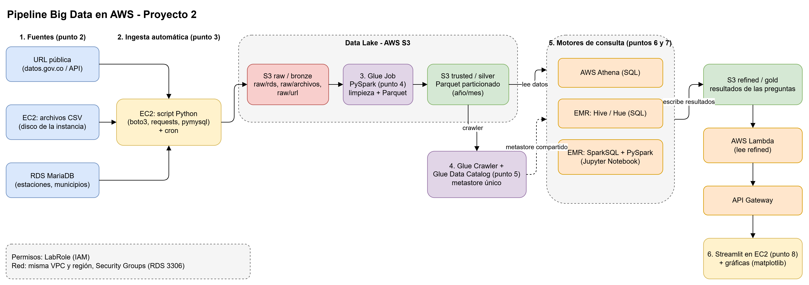

# Proyecto 2 de Big Data: natalidad en Colombia sobre AWS

Universidad EAFIT · SI3007 Sistemas Distribuidos / ST0263 Tópicos Especiales en Telemática · 2026-2

**Integrantes**

- <<Alyson Dahiana Henao Fernández, adhenaof@eafit.edu.co>>
- <<Sofía Gallo de la Rosa, sgallol2@eafit.edu.co>>

**Repositorio:** <<url del repositorio>>

---

## 1. Descripción

Pipeline de Big Data de extremo a extremo sobre AWS. Toma datos de natalidad de tres tipos de fuente (base de datos, archivos y una API en internet), los ingesta automáticamente a un data lake en S3, los prepara con Spark, los cataloga, los consulta con SQL y PySpark, y los expone en una visualización y una aplicación Streamlit detrás de API Gateway.

## 2. Caso de estudio y dataset

**Tema:** evolución de los nacimientos en Colombia (2021 a 2025), su distribución geográfica y las características de las madres y los partos, con contexto internacional.

| Fuente | Contenido | Dónde vive |
|---|---|---|
| **Archivos** | Microdatos de nacimientos del DANE (Estadísticas Vitales), un CSV por año, 2021 a 2025 | Instancia EC2 (Ubuntu) |
| **Base de datos** | Tablas de apoyo: divisiones político-administrativas (departamentos y municipios) y diccionarios de códigos de las variables | RDS MariaDB |
| **URL** | API pública Data360 del Banco Mundial (indicadores por país y año, comenzando por la tasa bruta de natalidad) | `https://data360api.worldbank.org/data360/data` |

### Datos del DANE

- Fuente: catálogo de microdatos del DANE (`microdatos.dane.gov.co`), Estadísticas Vitales, nacimientos.
- Registros aproximados por año (líneas del archivo menos el encabezado): 2021 → 616.914, 2022 → 573.625, 2023 → 515.549, 2024 → 453.901, 2025 → 441.537 (cerca de 2,6 millones en total, unos 400 MB).
- Los archivos de 2021 a 2023 tienen 39 columnas; los de 2024 y 2025 tienen 40. La columna agregada es `CODPAISNACMAD`, ubicada en medio del archivo (posición 22), por lo que los años se leen **por separado y se unen por nombre de columna**, nunca por posición (ver `04-glue-spark`).
- El portal del DANE no ofrece un enlace de descarga directo (entrega el archivo tras un formulario), por eso los archivos se descargan manualmente una vez y se alojan en la EC2, que actúa como fuente de archivos. Los datos **no se versionan en este repositorio** (solo una muestra pequeña).

### Reglas de calidad de datos identificadas

- Los códigos geográficos (`COD_DPTO`, `COD_MUNIC`) conservan ceros a la izquierda: se tratan siempre como **texto**.
- El valor `99` significa "sin información" en `EDAD_MADRE`, `EDAD_PADRE` y otras variables, y se convierte en nulo en la zona trusted (confirmar variable por variable en el diccionario del DANE).
- `EDAD_MADRE` es un **grupo de edad** (1 = 10-14 años, 2 = 15-19, ..., 9 = 50-54), no una edad en años. `EDAD_PADRE` sí son años cumplidos.

### Banco Mundial

- Base de datos `WB_WDI`; indicador verificado: `WB_WDI_SP_DYN_CBRT_IN` (tasa bruta de natalidad).
- Otros indicadores previstos (por confirmar con la API): población total y tasa de fecundidad.

## 3. Preguntas de negocio (borrador, se afinan con el avance)

1. ¿Cómo evolucionó el número de nacimientos por año y por departamento entre 2021 y 2025?
2. ¿Qué meses concentran más nacimientos?
3. ¿Qué departamentos y municipios concentran más nacimientos y qué proporción corresponde a madres adolescentes (grupos de 10 a 19 años)?
4. ¿Cómo se relaciona el nivel educativo de la madre con el número de controles prenatales y el tipo de parto?
5. ¿Cómo se compara la natalidad de Colombia con la de otros países, y coincide la tasa calculada con datos del DANE con la publicada por el Banco Mundial?

## 4. Arquitectura



Diagrama editable: [`docs/arquitectura-pipeline-bigdata.drawio`](docs/arquitectura-pipeline-bigdata.drawio).

### Organización del data lake (S3)

```
s3://bigdata-p2-<ACCOUNT_ID>/
├── raw/
│   ├── archivos/nacimientos/anio=2021 ... anio=2025/
│   ├── rds/
│   └── url/<indicador>/
├── trusted/        (Parquet, limpio, particionado)
├── refined/        (resultados de las preguntas de negocio)
├── athena-results/
└── scripts/        (scripts de los jobs de Glue)
```

## 5. Conceptos y tecnologías

- **Data lake por zonas** (raw / trusted / refined, equivalente a bronze / silver / gold) sobre Amazon S3.
- **Ingesta automática** multi-fuente (base de datos, archivos, API) con Python y cron.
- **Preparación de datos con Apache Spark** (PySpark) en AWS Glue: tipado, limpieza, valores faltantes y evolución de esquema entre años.
- **Catalogación:** AWS Glue Data Catalog y tablas externas de Hive en EMR.
- **SQL analítico** con Amazon Athena, Hive (Hue) y SparkSQL.
- **PySpark** para análisis descriptivo en notebooks de Jupyter sobre EMR.
- **Servicio y visualización:** AWS Lambda, API Gateway y Streamlit.

## 6. Estructura del repositorio

| Carpeta | Punto del enunciado | Tipo de contenido |
|---|---|---|
| [`00-infraestructura`](00-infraestructura) | Soporte | Comandos de despliegue (AWS CLI) |
| [`01-caso-estudio`](01-caso-estudio) | 1. Caso de estudio y preguntas | Documentación |
| [`02-fuentes`](02-fuentes) | 2. Fuentes de datos | Comandos + SQL + script de carga |
| [`03-ingesta`](03-ingesta) | 3. Ingesta al data lake | Código fuente (Python) + comandos de despliegue |
| [`04-glue-spark`](04-glue-spark) | 4. Preparación de datos | Código fuente (PySpark) + comandos de despliegue |
| [`05-catalogacion`](05-catalogacion) | 5. Catalogación | Comandos + DDL (HiveQL/SQL) |
| [`06-consultas-sql`](06-consultas-sql) | 6. Consultas SQL | Código SQL |
| [`07-pyspark`](07-pyspark) | 7. Análisis con PySpark | Código fuente (notebook `.ipynb`) |
| [`08-visualizacion-api`](08-visualizacion-api) | 8. Visualización y API | Código fuente (Python) + comandos de despliegue |
| [`docs`](docs) | Soporte | Diagrama y evidencias (pantallazos) |

Cada carpeta tiene su propio `README.md` con los pasos para reproducir ese punto, el código y las evidencias. Este README solo da la visión general y el orden de ejecución.

## 7. Cómo reproducir el proyecto

### Prerrequisitos

- Cuenta de AWS Academy (Learner Lab), región `us-east-1`, y AWS CLI configurada con las credenciales del lab (cambian en cada sesión).
- Python 3.10 o superior para los scripts locales.
- Los archivos CSV del DANE descargados manualmente (instrucciones en [`02-fuentes`](02-fuentes)).

### Variables de entorno

Copiar `vars.example.cmd` (Windows) o `vars.example.sh` (bash), completar los valores y cargarlos:

```bat
call vars.cmd
```

```bash
source vars.sh
```

Los archivos con valores reales (`vars.cmd`, `vars.sh`), las llaves (`*.pem`) y los datos (`*.csv`, `*.zip`) están en `.gitignore` y no se suben al repositorio.

### Orden de ejecución

1. [`00-infraestructura`](00-infraestructura): bucket de S3, security group, EC2, RDS y cluster EMR.
2. [`02-fuentes`](02-fuentes): cargar las tablas de apoyo en RDS y descargar manualmente los CSV del DANE.
3. [`03-ingesta`](03-ingesta): cargar los CSV manualmente a `raw/archivos/` y ejecutar la ingesta automática de RDS y la API hacia `raw/`.
4. [`04-glue-spark`](04-glue-spark): correr el job de Glue (raw a trusted).
5. [`05-catalogacion`](05-catalogacion): catalogar trusted en Glue y en Hive.
6. [`06-consultas-sql`](06-consultas-sql) y [`07-pyspark`](07-pyspark): ejecutar las consultas y el notebook.
7. [`08-visualizacion-api`](08-visualizacion-api): desplegar Lambda, API Gateway y Streamlit.

## 8. Consideraciones sobre AWS Academy

- Las sesiones del Learner Lab son de duración limitada y el crédito es finito: el cluster EMR se crea para la sesión de análisis y se termina al acabar. Todo lo que importa vive en S3 y no en HDFS.
- No se pueden crear roles IAM propios: se usa `LabRole` y `LabInstanceProfile`.
- Nombres de recursos con el prefijo `bigdata-p2` y nada de valores fijos en el código (endpoints, buckets y cuenta salen de variables de entorno).

## 9. Estado del proyecto

- [x] Infraestructura base: bucket S3 con zonas, security group, EC2, RDS MariaDB
- [x] Archivos CSV 2021 a 2025 cargados manualmente en `raw/archivos/nacimientos/`
- [x] Endpoint del Banco Mundial verificado
- [x] Tablas de apoyo en RDS (departamentos, municipios, diccionarios)
- [x] Ingesta de RDS y API ejecutada hacia `raw/`
- [ ] Glue Job raw a trusted (punto 4)
- [ ] Catalogación (punto 5)
- [ ] Consultas SQL (punto 6)
- [ ] Análisis con PySpark (punto 7)
- [ ] Visualización y API (punto 8)

## 10. Referencias

- DANE, Catálogo de microdatos: Estadísticas Vitales (nacimientos).
- Banco Mundial, Data360 API.
- Material del curso: Hive, Athena y Glue; Spark y PySpark.
